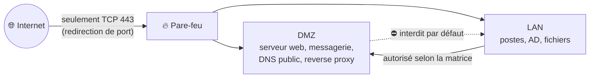
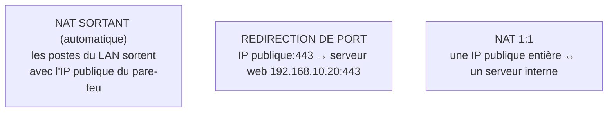

# Module 2 : Exposer des services vers l'extérieur

*Cours : [Cours 16 - Réseau et sécurité](../index.md)*

## 🎯 Objectif du module

Rendre un service **accessible depuis Internet** sans exposer le réseau interne : le **NAT** (sortant, redirection de port, 1:1), la **DMZ**, et les protections face aux **attaques** (IDS/IPS, EDR, Zero Trust, bastion).

!!! abstract "En clair"
    Ton site web doit être joignable depuis Internet, mais tes postes et ton Active Directory, **jamais**. On place donc les serveurs exposés dans une **zone tampon**, la **DMZ** : si un pirate prend le serveur web, il reste **coincé** dans la DMZ. Le pare-feu **redirige** vers elle seulement les ports nécessaires (443…).

## 🗺️ L'essentiel en schémas

!!! info "Référentiel TSSR 2026"
    **CCP 2 · compétence 7 : Gérer les accès et la sécurité** et **compétence 4 : Exploiter un réseau IP** (NAT, redirections).

**① Une architecture avec DMZ**

**② Les trois NAT de pfSense**

## 📖 Cours consolidé

### 1. Rappels sur le NAT

Les adresses **privées** (10.0.0.0/8, 172.16.0.0/12, 192.168.0.0/16) **ne circulent pas sur Internet** : il faut les **traduire** ([cours 8 · module 4](../../cours-08-les-services-reseau-en-environnement-microsoft/module-4-le-routage/index.md)).

| NAT | Sens | Principe |
|---|---|---|
| **Dynamique** (NAT **source**, PAT) | Du LAN **vers** Internet | Toutes les machines sortent avec **l'IP publique du routeur** ; les **ports** permettent de renvoyer chaque réponse à la bonne machine |
| **Statique** (NAT **destination**) | D'Internet **vers** un serveur | Une correspondance **fixe** : ce qui arrive sur l'IP publique (et un port) est envoyé à **une** machine interne |

### 2. Le NAT dans pfSense

| Menu *Pare-feu → NAT* | Usage |
|---|---|
| **Redirection de port** (*Port Forward*) | Une requête qui arrive sur l'**adresse WAN**, sur **un port** (ex. 443), est envoyée à **un serveur interne** ; pfSense crée la règle de pare-feu associée |
| **1:1** | Une **IP publique complète** est associée à **une** machine interne (avec des **IP virtuelles** côté WAN) |
| **NAT sortant** (*Outbound*) | **Automatique** par défaut pour tous les réseaux internes ; mode **hybride** (automatique + règles ajoutées) ou **manuel** |

⚠️ Rediriger **RDP (3389)** directement depuis Internet est une **très mauvaise idée** : c'est une des portes d'entrée préférées des rançongiciels. On passe par un **VPN** ([module 3](../module-3-les-collaborateurs-et-le-teletravail/index.md)) ou un **bastion**.

### 3. La DMZ

**DMZ** (zone démilitarisée) = un **sous-réseau séparé**, entre Internet et le LAN, pour les services **exposés** : **serveur web**, **messagerie**, **DNS public**, FTP, **reverse proxy**.

| ➕ | ➖ |
|---|---|
| Une **couche de protection** de plus : un serveur compromis ne donne pas accès au LAN | Un peu de **latence** (routage et filtrage en plus) |
| Le LAN **n'est jamais** joignable directement depuis Internet | Configuration et **règles** plus nombreuses à maintenir |

Règle d'or : **DMZ → LAN interdit** par défaut ; seuls des flux **précis** sont ouverts.

### 4. Les attaques à connaître

| Attaque | Principe |
|---|---|
| **Virus**, **ver** | Programme malveillant ; le ver se **propage seul** sur le réseau |
| **Cheval de Troie** | Programme d'apparence normale qui cache une fonction malveillante |
| **Rançongiciel** | **Chiffre** les données et demande une rançon |
| **DDoS** (déni de service distribué) | **Sature** un serveur pour le rendre injoignable |
| **Hameçonnage** (*phishing*) | Faux mail ou faux site pour voler des identifiants |
| **Injection SQL** | Du code SQL glissé dans un formulaire pour manipuler la base |

### 5. Les protections

| Outil | Rôle |
|---|---|
| **IDS** (*Intrusion Detection System*) | **Détecte** les comportements suspects et **alerte** (réseau ou hôte) |
| **IPS** (*Intrusion Prevention System*) | Détecte **et bloque** automatiquement (ex. Suricata, Snort sur pfSense) |
| **EDR** | Surveille **les postes et serveurs** en temps réel et réagit (isoler un PC infecté) |
| **XDR** | Comme l'EDR, en croisant **réseau, cloud, messagerie, applications** |
| **MDR** | Un **service** d'experts qui surveille et réagit pour l'entreprise |
| **Zero Trust (ZTNA)** | **Ne faire confiance à personne**, même à l'intérieur : chaque accès est **vérifié** |
| **Bastion** | Serveur **dédié et durci**, **seul point d'entrée** pour administrer les systèmes critiques, avec **traçabilité** des sessions |

## 📝 Fiche de révision

| Notion | À retenir |
|---|---|
| **NAT source (PAT)** | Le LAN sort avec l'IP publique |
| **NAT destination** | Internet → un serveur interne |
| **Redirection de port** | IP WAN:port → serveur:port |
| **NAT 1:1** | Une IP publique ↔ un serveur |
| **DMZ** | Zone tampon pour les services exposés, DMZ → LAN interdit |
| **IDS / IPS** | Détecter / détecter et bloquer |
| **EDR / XDR** | Surveillance des terminaux / de tout le SI |
| **Zero Trust** | Vérifier chaque accès |
| **Bastion** | Point d'entrée unique et tracé pour l'administration |

### ⚠️ Les pièges

- Exposer **RDP** ou **SMB** directement sur Internet.
- Un serveur en DMZ avec une règle **DMZ → LAN « tout »** : la DMZ ne sert plus à rien.
- Oublier que la redirection de port ouvre aussi une **règle de pare-feu**.
- **IDS ≠ IPS** : l'IDS ne bloque rien.

### ✏️ Entraîne-toi (clique pour voir la correction)

??? question "1. Le site web interne (192.168.10.20) doit être accessible en HTTPS depuis Internet. Que configures-tu dans pfSense, et où places-tu ce serveur ?"
    Le serveur va en **DMZ**. Dans pfSense : une **redirection de port** WAN, TCP **443**, vers 192.168.10.20:443 (avec sa règle de pare-feu). Les règles **DMZ → LAN** restent fermées, sauf un flux précis si le site doit joindre une base interne.

## 🧠 Quiz — entraîne-toi

