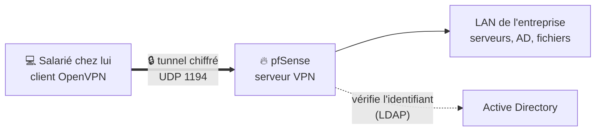
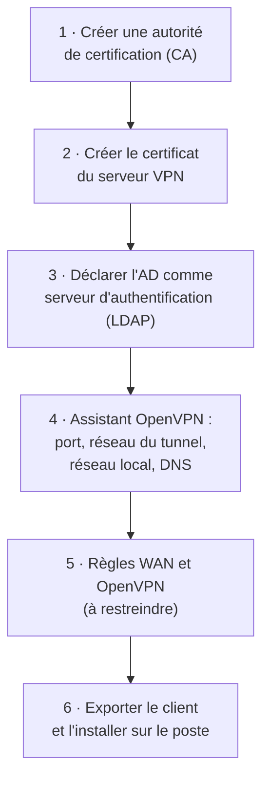

# Module 3 : Les collaborateurs et le télétravail

*Cours : [Cours 16 - Réseau et sécurité](../index.md)*

## 🎯 Objectif du module

Permettre aux collaborateurs **en télétravail** d'accéder au réseau de l'entreprise de façon sûre : le **VPN d'accès distant**, les **protocoles** (OpenVPN, WireGuard, IKEv2, L2TP/IPsec) et leur mise en place sur **pfSense**.

!!! abstract "En clair"
    Un **VPN** crée un **tunnel chiffré** à travers Internet entre le PC du salarié et le pare-feu de l'entreprise. Pour le PC, c'est **comme s'il était branché au bureau** : il reçoit une adresse du réseau du tunnel et peut joindre les serveurs internes, sans que personne sur Internet ne puisse lire les échanges.

## 🗺️ L'essentiel en schémas

!!! info "Référentiel TSSR 2026"
    **CCP 2 · compétence 7 : Gérer les accès et la sécurité dans un environnement hybride** : donner un accès distant sécurisé aux utilisateurs.

**① Le VPN d'accès distant**

**② OpenVPN sur pfSense, dans l'ordre**

## 📖 Cours consolidé

### 1. Le VPN

**VPN** (*Virtual Private Network*) = un **tunnel** entre deux points à travers un réseau non sûr (Internet), avec :

- le **chiffrement** : personne ne peut lire les données ;
- l'**authentification** : seuls les utilisateurs ou sites autorisés se connectent ;
- l'**intégrité** : les données ne sont pas modifiées en route.

| Type | Qui est relié | Exemple |
|---|---|---|
| **Accès distant** (*client-to-site*) | **Un poste** ↔ le réseau de l'entreprise | Télétravail, commerciaux en déplacement (ce module) |
| **Site à site** | **Un réseau** ↔ **un autre réseau** | Siège ↔ agence ([module 4](../module-4-relier-des-sites-distants-de-maniere-securisee/index.md)) |

### 2. Les protocoles

| Protocole | À retenir |
|---|---|
| **PPTP** | Ancien et **vulnérable** : à ne **plus** utiliser |
| **L2TP/IPsec** | L2TP fait le tunnel, **IPsec** le chiffre ; solide mais souvent bloqué par les NAT |
| **IKEv2/IPsec** | Rapide, se **reconnecte** bien quand on change de réseau (mobilité) |
| **OpenVPN** | Libre, très répandu, basé sur **TLS** et des **certificats** ; port par défaut **UDP 1194** ; intégré à pfSense |
| **WireGuard** | Récent, **très rapide**, code court ; fonctionne avec des **paires de clés** ; port par défaut **UDP 51820** ; paquet à ajouter sur pfSense |

### 3. OpenVPN sur pfSense

| Étape | Où | Détail |
|---|---|---|
| **Autorité de certification** | *Système → Gestionnaire de certificats → CA* | Une CA interne dédiée au VPN |
| **Certificat serveur** | *… → Certificats* | Signé par cette CA, de type **certificat serveur** (RSA 2048, SHA-256) |
| **Serveur d'authentification** | *Système → Gestionnaire d'usagers → Serveurs d'authentification* | L'**AD** en **LDAP** (389) ou mieux **LDAPS** (636) ([module 5](../module-5-authentifier-et-securiser-les-echanges/index.md)) : les salariés gardent **leur compte** du domaine |
| **Assistant OpenVPN** | *VPN → OpenVPN → Wizards* | Port **UDP 1194**, **réseau du tunnel** (ex. 10.8.0.0/24, adresses données aux clients), **réseau local** accessible, **DNS** et **domaine** à pousser |
| **Règles** | Coché dans l'assistant | Une règle **WAN** (UDP 1194) et un onglet **OpenVPN** créé « tout ouvert » : à **restreindre** à ce qui est utile |
| **Export du client** | Paquet **openvpn-client-export** | Un **installateur** avec certificat et configuration ; option `auth-nocache` pour ne pas garder le mot de passe en mémoire |

Côté poste : installer, clic droit sur l'icône → **Connecter**, saisir l'identifiant **avec le domaine**. Vérifier avec `ipconfig /all` : une adresse du **réseau du tunnel**, le **DNS** et le **suffixe** du domaine.

### 4. WireGuard sur pfSense

1. Installer le paquet **WireGuard** (*Système → Gestionnaire de paquets*).
2. Créer un **tunnel** : il **génère** une **clé privée** et une **clé publique** ; choisir le **réseau du tunnel** (ex. 172.40.200.0/24).
3. Ajouter chaque client en **pair** (*peer*) avec **sa clé publique** et son adresse dans le tunnel.
4. Ouvrir sur le **WAN** le port **UDP 51820** et autoriser les flux sur l'interface WireGuard.
5. Sur le client, lancer le tunnel et **tester** : `ping` d'une adresse privée du réseau de l'entreprise.

## 📝 Fiche de révision

| Notion | À retenir |
|---|---|
| **VPN** | Tunnel chiffré et authentifié à travers Internet |
| **Accès distant / site à site** | Un poste ↔ réseau / réseau ↔ réseau |
| **PPTP** | Obsolète, à bannir |
| **OpenVPN** | TLS + certificats, UDP **1194** |
| **WireGuard** | Paires de clés, UDP **51820**, très rapide |
| **IKEv2** | Mobilité, avec IPsec |
| **Réseau du tunnel** | Les adresses données aux clients VPN |
| **Authentification** | Comptes AD via LDAP / LDAPS |

### ⚠️ Les pièges

- Le **réseau du tunnel** ne doit **pas** chevaucher le LAN de l'entreprise **ni** celui du domicile (192.168.1.0/24 est très courant chez soi).
- Laisser la règle **OpenVPN « tout ouvert »** créée par l'assistant.
- Oublier le **domaine** dans l'identifiant de connexion.
- Utiliser **LDAP 389** en production : le mot de passe passe **en clair** ; préférer **LDAPS**.

### ✏️ Entraîne-toi (clique pour voir la correction)

??? question "1. Un salarié est connecté au VPN mais n'arrive pas à ouvrir \\\\srv-fichiers. Que vérifies-tu ?"
    1) `ipconfig /all` : a-t-il une adresse du **réseau du tunnel** et le bon **DNS** ? · 2) `ping` de l'**IP** du serveur (routage, règles de l'onglet **OpenVPN** du pare-feu) · 3) si l'IP répond mais pas le nom, c'est le **DNS** ou le **suffixe** poussé par le VPN · 4) son réseau domestique n'utilise-t-il pas **la même plage** que le LAN ?

## 🧠 Quiz — entraîne-toi

