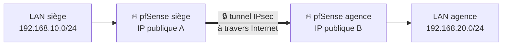
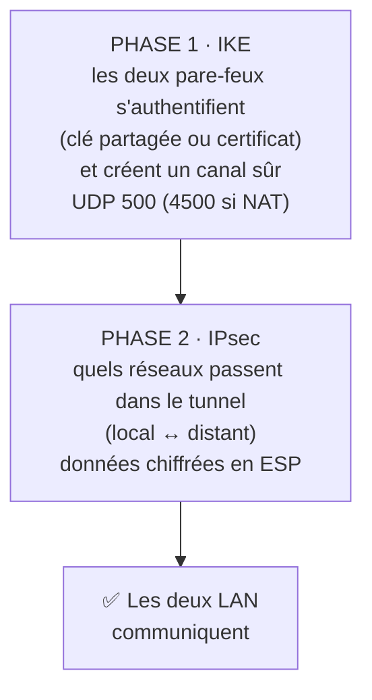

# Module 4 : Relier des sites distants de manière sécurisée

*Cours : [Cours 16 - Réseau et sécurité](../index.md)*

## 🎯 Objectif du module

Relier **deux sites** (siège et agence) par un **VPN site à site IPsec** : comprendre les **deux phases** (IKE puis IPsec), les paramètres à faire **correspondre** des deux côtés, et vérifier le tunnel sur **pfSense**.

!!! abstract "En clair"
    Plutôt que d'installer un client VPN sur chaque poste de l'agence, on relie **les deux pare-feux** entre eux. Les postes n'ont rien à faire : quand un PC de l'agence veut joindre un serveur du siège, son pare-feu **chiffre** le paquet et l'envoie dans le tunnel.

## 🗺️ L'essentiel en schémas

!!! info "Référentiel TSSR 2026"
    **CCP 2 · compétence 4 : Exploiter un réseau IP** et **compétence 7 : Gérer les accès et la sécurité** : interconnecter des sites de façon sécurisée.

**① Le VPN site à site**

**② Les deux phases d'IPsec**

## 📖 Cours consolidé

### 1. IPsec en deux phases

| Phase | Rôle | Paramètres (identiques **des deux côtés**) |
|---|---|---|
| **Phase 1 – IKE** (*Internet Key Exchange*) | Les deux passerelles **s'authentifient** et **négocient les clés** : c'est le canal de contrôle | Version **IKEv2**, **adresse publique** du pair, **authentification** (clé pré-partagée *PSK* ou certificat), **chiffrement** (AES), **hachage** (SHA-256), **groupe Diffie-Hellman**, durée de vie |
| **Phase 2 – IPsec** | Le tunnel qui **transporte les données** | **Réseau local** et **réseau distant**, protocole **ESP** (chiffrement), algorithmes, PFS, durée de vie |

| Flux à autoriser sur le WAN | Usage |
|---|---|
| **UDP 500** | IKE |
| **UDP 4500** | NAT-T (IPsec quand un **NAT** se trouve sur le chemin) |
| Protocole **ESP** (IP 50) | Les données chiffrées |

### 2. Sur pfSense

1. *VPN → IPsec → Tunnels* : **ajouter une phase 1** (IKEv2, interface **WAN**, IP publique **du site d'en face**, clé pré-partagée **longue**, AES/SHA-256/DH).
2. Sous ce tunnel, **ajouter une phase 2** : réseau **local** (ex. 192.168.10.0/24) et réseau **distant** (192.168.20.0/24).
3. Faire **la même chose en miroir** sur l'autre pare-feu (local et distant **inversés**, mêmes algorithmes, même clé).
4. *Pare-feu → Règles → IPsec* : autoriser les flux entre les deux LAN (selon la **matrice de flux**).
5. *Statut → IPsec* : le tunnel doit être **établi** ; tester par un `ping` d'un poste à l'autre.

### 3. Dépanner un tunnel

| Symptôme | Piste |
|---|---|
| Phase 1 ne monte pas | **Clé**, **IP du pair**, algorithmes ou version IKE **différents** ; UDP 500/4500 bloqué |
| Phase 1 OK, phase 2 non | Les **réseaux** local/distant ne sont pas **le miroir** l'un de l'autre |
| Tunnel établi mais pas de ping | **Règles** de l'onglet IPsec, pare-feu **Windows** du poste, passerelle des postes |
| Les deux LAN ont la même plage | **Impossible à router** : il faut des plages **différentes** sur chaque site |

Les journaux sont dans *Statut → Journaux système → IPsec*.

## 📝 Fiche de révision

| Notion | À retenir |
|---|---|
| **Site à site** | Passerelle ↔ passerelle, rien sur les postes |
| **Phase 1 (IKE)** | Authentification des pairs et clés, UDP 500 / 4500 |
| **Phase 2 (IPsec)** | Réseaux local ↔ distant, données en ESP |
| **PSK** | Clé pré-partagée, identique des deux côtés |
| **Miroir** | Local d'un côté = distant de l'autre |
| **NAT-T** | UDP 4500 quand un NAT est sur le chemin |
| **Vérifier** | Statut → IPsec, journaux IPsec, `ping` |

### ⚠️ Les pièges

- Deux sites avec **la même plage** IP (192.168.1.0/24 partout).
- Un seul paramètre différent en phase 1 (version, hachage, groupe DH) et le tunnel ne monte pas.
- Oublier les **règles de l'onglet IPsec** : tunnel « vert » mais rien ne passe.
- Une **clé pré-partagée** courte ou envoyée par mail en clair.

### ✏️ Entraîne-toi (clique pour voir la correction)

??? question "1. Le tunnel entre le siège (192.168.10.0/24) et l'agence (192.168.20.0/24) est établi en phase 1, mais pas en phase 2. Que vérifies-tu ?"
    Les **réseaux** de la phase 2 : au siège local 192.168.10.0/24 → distant 192.168.20.0/24, à l'agence **l'inverse** exact. Puis les **algorithmes** de phase 2 (identiques des deux côtés) et les journaux *IPsec*.

## 🧠 Quiz — entraîne-toi

