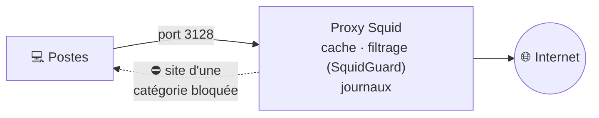
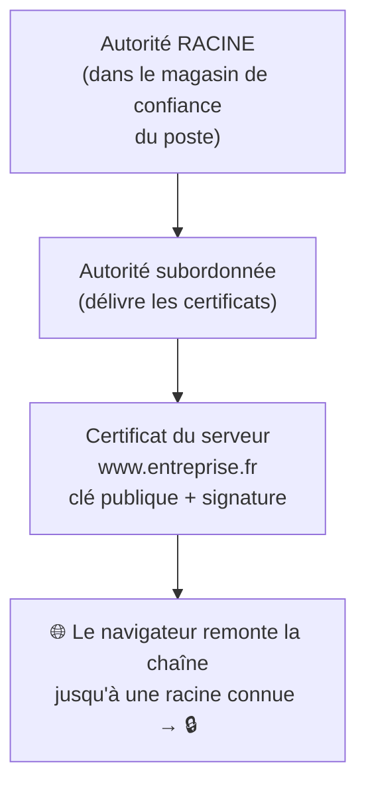

# Module 5 : Authentifier et sécuriser les échanges

*Cours : [Cours 16 - Réseau et sécurité](../index.md)*

## 🎯 Objectif du module

**Authentifier** les utilisateurs et **sécuriser** les échanges : le **proxy** et le filtrage Web, le **portail captif**, les **certificats** (cryptographie, TLS, PKI, Let's Encrypt), un site en **HTTPS** sous **Apache** et **IIS**, et **LDAPS**.

!!! abstract "En clair"
    Le **proxy** va sur le Web **à la place** des postes : il peut filtrer les sites et garder une trace. Le **certificat** est la **carte d'identité** d'un serveur : il prouve au navigateur qu'il parle bien au bon site, et permet de **chiffrer** les échanges (le cadenas HTTPS).

## 🗺️ L'essentiel en schémas

!!! info "Référentiel TSSR 2026"
    **CCP 2 · compétence 7 : Gérer les accès et la sécurité dans un environnement hybride** et **compétence 5 : Exploiter des serveurs** (services Web, certificats).

**① Le proxy entre les postes et Internet**



**② Comment un certificat inspire confiance**



## 📖 Cours consolidé

### 1. Le proxy (Squid sur pfSense)

| Notion | À retenir |
|---|---|
| **Proxy** | Intermédiaire qui fait les requêtes Web **à la place** des postes : **cache** (pages déjà vues), **filtrage** (ACL), **journaux** |
| **Explicite** | Le proxy est **déclaré** sur les postes (port **3128**), souvent par **GPO** |
| **Transparent** | Le pare-feu **intercepte** le trafic HTTP sans réglage sur les postes |
| **Interception SSL** | Pour filtrer le **HTTPS**, le proxy déchiffre et rechiffre (port **3129**) : il faut déployer **son certificat** de CA sur les postes |
| **SquidGuard** | Filtrage par **catégories** de sites avec des **listes noires** (celles de l'université Toulouse Capitole) |
| **Reverse proxy** | L'inverse : placé **devant les serveurs** (en DMZ), il reçoit les requêtes d'Internet |

**Obligation légale** : un fournisseur d'accès au public (et l'entreprise qui fournit l'accès à Internet) doit **conserver** les données de connexion **un an** (code des postes et des communications électroniques, article **L34-1**).

### 2. Le portail captif

Une **page d'authentification** qui s'affiche avant tout accès à Internet (Wi-Fi invités, hôtel). Sur pfSense, *Services → Portail captif* : sur **une interface** (ex. le Wi-Fi invités), avec des **comptes locaux**, des **bons** (*vouchers*) ou un annuaire, une **durée** de session et une **page** personnalisée.

### 3. La cryptographie en bref

| Notion | Principe |
|---|---|
| **Symétrique** | **Une seule clé** pour chiffrer et déchiffrer : **rapide** (AES) ; problème : partager la clé |
| **Asymétrique** | Une **clé publique** (pour chiffrer, diffusée) et une **clé privée** (pour déchiffrer, **jamais** partagée) : RSA, ECDSA |
| **Hachage** | Une **empreinte** unique des données pour vérifier qu'elles n'ont pas changé (SHA-256) |
| **TLS** | Le protocole du HTTPS : l'**asymétrique** sert à échanger une clé, puis le **symétrique** chiffre la session ; versions **1.2** et **1.3** (les anciennes, SSL et TLS 1.0/1.1, sont à désactiver) |
| **Certificat** | La **clé publique** du serveur + son **nom** + la **signature** d'une **autorité de certification** (CA) |

| Type de certificat | Usage |
|---|---|
| **Auto-signé** | Tests, labo : le navigateur **avertit** |
| **PKI interne** (**ADCS** sous Windows) | Certificats de l'entreprise, approuvés par les postes du domaine (via GPO) |
| **Autorité publique** / **Let's Encrypt** | Sites publics ; Let's Encrypt est **gratuit**, **automatisé**, certificats de **90 jours** à renouveler automatiquement |

### 4. Une PKI avec ADCS (Windows Server)

- Rôle **Services de certificats Active Directory** : une **autorité racine** (idéalement **hors ligne**) et une **autorité subordonnée** qui délivre.
- **Modèles** de certificats : on **duplique** un modèle (ex. *Serveur Web*), on règle la durée et les droits, puis on le **publie**.
- **Inscription Web** : `http://serveur/certsrv` pour demander un certificat.

### 5. HTTPS sous Apache (Linux)

| Élément | Rôle |
|---|---|
| `/etc/apache2/apache2.conf` | Configuration générale |
| `ports.conf` | Ports écoutés (80, 443) |
| `sites-available/` → `sites-enabled/` | Les sites (VirtualHost) disponibles / actifs |
| `mods-available/` → `mods-enabled/` | Les modules disponibles / actifs |

```bash
# Certificat auto-signé (labo)
openssl genrsa -out site.key 2048                               # clé privée
openssl req -new -key site.key -out site.csr                    # demande de certificat
openssl x509 -req -days 365 -in site.csr -signkey site.key -out site.crt

sudo a2enmod ssl                    # activer le module SSL
sudo a2ensite site-ssl.conf         # activer le site
sudo apache2ctl configtest          # vérifier la syntaxe → « Syntax OK »
sudo systemctl reload apache2
```

```apache
<VirtualHost *:443>
    ServerName www.entreprise.lan
    DocumentRoot /var/www/site
    SSLEngine on
    SSLCertificateFile    /etc/ssl/certs/site.crt
    SSLCertificateKeyFile /etc/ssl/private/site.key
</VirtualHost>
```

### 6. HTTPS sous IIS (Windows Server)

```powershell
Install-WindowsFeature Web-Server -IncludeManagementTools   # installer IIS
Get-Service W3SVC                                           # le service Web
```

Dans le **Gestionnaire IIS** : importer ou demander le **certificat** (*Certificats de serveur*), puis sur le site **Liaisons** → ajouter **https**, port **443**, choisir le certificat.

### 7. LDAPS

**LDAP** (389) envoie les identifiants **en clair**. **LDAPS** (**636**) les chiffre en TLS : le contrôleur de domaine a besoin d'un **certificat** (délivré par l'ADCS). Test avec `ldp.exe` (connexion au port 636, case **SSL**). C'est ce qu'on utilise pour que **pfSense** ou le VPN interroge l'AD ([module 3](../module-3-les-collaborateurs-et-le-teletravail/index.md)).

## 📝 Fiche de révision

| Notion | À retenir |
|---|---|
| **Proxy** | Cache, filtrage, journaux · Squid, port **3128** |
| **Transparent / explicite** | Interception / déclaré sur les postes |
| **SquidGuard** | Filtrage par catégories, listes noires |
| **Conservation** | Données de connexion **1 an** (L34-1 CPCE) |
| **Portail captif** | Page d'authentification avant Internet |
| **Symétrique / asymétrique** | Une clé (AES) / clé publique + privée (RSA) |
| **Certificat** | Clé publique + nom + signature d'une CA |
| **TLS** | 1.2 et 1.3 seulement |
| **Let's Encrypt** | Gratuit, 90 jours, renouvellement automatique |
| **Apache** | `a2enmod ssl`, `a2ensite`, `apache2ctl configtest` |
| **IIS** | `Install-WindowsFeature Web-Server`, Liaisons https 443 |
| **LDAPS** | Port **636**, certificat sur le DC |

### ⚠️ Les pièges

- La **clé privée** ne se partage **jamais** (droits restreints sur le fichier `.key`).
- Un certificat dont le **nom** ne correspond pas à l'adresse tapée : alerte du navigateur.
- Un certificat **expiré** : le site devient « non sécurisé » du jour au lendemain ; surveiller les dates.
- Interception SSL sans déployer le **certificat du proxy** : erreurs sur tous les sites HTTPS.
- Recharger Apache **sans** `apache2ctl configtest` : le service peut ne pas redémarrer.

### ✏️ Entraîne-toi (clique pour voir la correction)

??? question "1. Les utilisateurs ont une alerte de sécurité en ouvrant l'intranet https://intranet.entreprise.lan. Quelles causes possibles ?"
    1) Certificat **auto-signé** ou d'une CA **non approuvée** par les postes (déployer la racine par **GPO**) · 2) **nom** du certificat différent de l'adresse tapée · 3) certificat **expiré** · 4) chaîne incomplète (autorité **subordonnée** manquante sur le serveur).

## 🧠 Quiz — entraîne-toi

<div id="quiz-cours-16-reseau-et-securite-module-5-authentifier-et-securiser-les-echanges"></div>

<script type="application/json" id="quiz-cours-16-reseau-et-securite-module-5-authentifier-et-securiser-les-echanges-data">
[
  {
    "question": "Quel est le port par défaut du proxy Squid ?",
    "options": [
      "80",
      "3128",
      "8443",
      "1194"
    ],
    "correctIndex": 1,
    "explanation": "3129 est souvent utilisé pour l'interception SSL."
  },
  {
    "question": "Qu'est-ce qu'un proxy transparent ?",
    "options": [
      "Un proxy sans journaux",
      "Un proxy qui intercepte le trafic sans réglage sur les postes",
      "Un proxy placé devant les serveurs",
      "Un VPN"
    ],
    "correctIndex": 1,
    "explanation": "Un proxy explicite est déclaré sur les postes."
  },
  {
    "question": "Combien de temps faut-il conserver les données de connexion fournies au public ?",
    "options": [
      "1 mois",
      "1 an",
      "5 ans",
      "Pas d'obligation"
    ],
    "correctIndex": 1,
    "explanation": "Article L34-1 du code des postes et des communications électroniques."
  },
  {
    "question": "En cryptographie asymétrique, quelle clé ne doit jamais être partagée ?",
    "options": [
      "La clé publique",
      "La clé privée",
      "Les deux",
      "Aucune"
    ],
    "correctIndex": 1,
    "explanation": "La clé publique est diffusée, par exemple dans le certificat."
  },
  {
    "question": "Que contient un certificat de serveur ?",
    "options": [
      "La clé privée du serveur",
      "La clé publique, le nom du serveur et la signature d'une autorité",
      "Le mot de passe administrateur",
      "La liste des utilisateurs"
    ],
    "correctIndex": 1,
    "explanation": "Le navigateur vérifie la signature jusqu'à une autorité racine de confiance."
  },
  {
    "question": "Quelle commande vérifie la syntaxe de la configuration Apache ?",
    "options": [
      "apache2 --check",
      "apache2ctl configtest",
      "a2ensite test",
      "systemctl verify apache2"
    ],
    "correctIndex": 1,
    "explanation": "Elle doit répondre « Syntax OK » avant un reload."
  },
  {
    "question": "Sur quel port fonctionne LDAPS ?",
    "options": [
      "389",
      "443",
      "636",
      "3268"
    ],
    "correctIndex": 2,
    "explanation": "LDAP en clair utilise 389."
  },
  {
    "question": "Quelle commande installe IIS avec ses outils d'administration ?",
    "options": [
      "Install-WindowsFeature Web-Server -IncludeManagementTools",
      "apt install iis",
      "Add-IIS -All",
      "Enable-WebServer"
    ],
    "correctIndex": 0,
    "explanation": "Le service Web s'appelle W3SVC."
  },
  {
    "question": "Which TLS versions should be enabled today?",
    "options": [
      "SSL 3.0 and TLS 1.0",
      "TLS 1.2 and TLS 1.3",
      "TLS 1.1 only",
      "None"
    ],
    "correctIndex": 1,
    "explanation": "SSL et TLS 1.0/1.1 sont obsolètes."
  }
]
</script>

<script>
  document.addEventListener("DOMContentLoaded", function () {
    TSSRQuiz.init({
      containerId: "quiz-cours-16-reseau-et-securite-module-5-authentifier-et-securiser-les-echanges",
      dataId: "quiz-cours-16-reseau-et-securite-module-5-authentifier-et-securiser-les-echanges-data",
    });
  });
</script>
