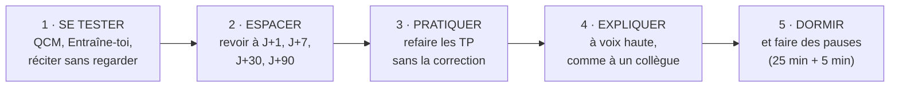
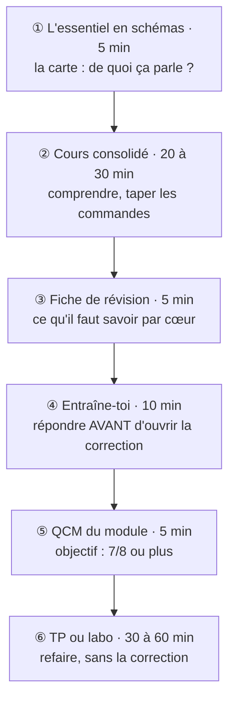
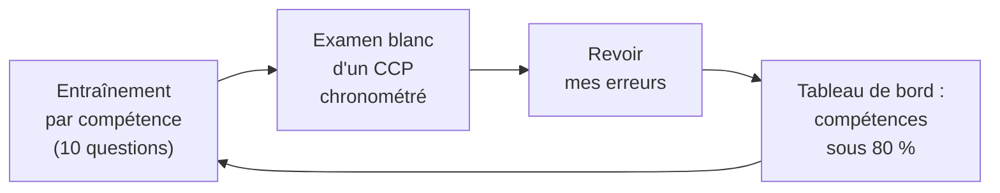

# 🧭 Méthodologie : apprendre efficacement

Comment réviser **au fil de la formation** pour arriver prêt à l'examen, en utilisant **les cours du site**, **les TP** faits en formation et le **QCM examen**. En bas de page, **ton planning de révision** commence aujourd'hui, étape par étape, avec le temps à y consacrer ; tu peux le **modifier**.

!!! abstract "En clair"
    On retient mieux en **se testant** qu'en relisant, en **revenant** sur un cours plusieurs fois (après 1 jour, 1 semaine, 1 mois) plutôt qu'en une seule grosse séance, et en **pratiquant** (TP). Un peu **chaque jour** vaut mieux que beaucoup la veille.

## 🧠 Les 5 règles qui marchent

| Règle | Pourquoi | Comment, concrètement |
|---|---|---|
| **Se tester** (rappel actif) | Chercher une réponse dans sa mémoire la renforce bien plus que relire | Faire le QCM du module **avant** de relire ; cacher la fiche et la réciter |
| **Espacer** (répétition espacée) | On oublie vite : chaque révision au bon moment repousse l'oubli | Revoir chaque cours à **J+1, J+7, J+30, J+90** (le planning ci-dessous le fait pour toi) |
| **Pratiquer** | Le métier est pratique et l'examen aussi | Refaire chaque TP **sans** la correction, en VM ou dans Packet Tracer |
| **Expliquer** | Si tu ne sais pas l'expliquer simplement, tu ne l'as pas encore compris | Expliquer un schéma à voix haute ; c'est aussi l'entraînement à l'entretien |
| **Dormir et faire des pauses** | La mémoire se consolide pendant le sommeil | Séances de **25 min** + 5 min de pause ; pas de nuit blanche avant l'examen |

## 📚 Utiliser un module du site

Chaque module suit le même ordre : utilise-le **dans cet ordre**.

- Un QCM raté : lis l'**explication**, relis la partie du cours, et **refais** le QCM le lendemain.
- La page **Révisions** regroupe une fiche par cours : c'est ton support de révision **J+7, J+30, J+90**.
- Les pages **Commandes** et **Mémo** servent d'aide-mémoire pendant les TP.

## 🛠️ Tirer le maximum des TP de la formation

| Étape | À faire |
|---|---|
| **Pendant le TP** | Noter chaque commande et **pourquoi** tu l'utilises ; faire des **captures** des étapes clés |
| **Le soir même** | Écrire une **procédure** de 10 lignes : objectif, étapes, vérification (`show`, `ping`, `Get-…`), piège rencontré |
| **J+7** | **Refaire** le TP de zéro, sans la correction ni tes notes, puis comparer |
| **Garder** | Tes VM, maquettes Packet Tracer et procédures dans un dossier par cours : c'est ta boîte à outils pour le stage et l'examen |
| **Expliquer** | Raconter le TP à voix haute en 3 minutes : le besoin, ce que tu as fait, comment tu as vérifié |

## 🎯 Le QCM examen

- **Pendant la formation** : un **entraînement par compétence** après chaque cours, puis l'**examen blanc** du CCP dès que ses cours sont faits.
- **Objectif** : **80 %** dans chaque compétence (la ligne pointillée des courbes).
- Le [tableau de bord des profils](../qcm-examen/tableau-de-bord.md) te dit quoi réviser en priorité : commence toujours par la compétence la plus faible.

## 🗓️ Mon planning de révision

Le planning démarre **aujourd'hui** et suit les dates du [programme](../programme/index.md) : chaque semaine indique quoi faire et combien de temps. **Modifie-le** à ta façon : dates, temps disponible, cases à cocher, tâches à ajouter ou supprimer, notes. Tout est enregistré **dans ce navigateur**.

<noscript>Active JavaScript pour afficher le planning.</noscript>

## 🏁 Les derniers jours

| Quand | À faire |
|---|---|
| **J-14 → J-8** | Un examen blanc **chronométré** par jour (CCP 1, 2, 3 à tour de rôle) + « Revoir mes erreurs » |
| **J-7 → J-2** | Fiches de révision des compétences les plus faibles ; réexpliquer tes TP à voix haute |
| **J-1** | Relecture **légère** des fiches, préparer tes papiers et ton trajet, **dormir** |
| **Jour J** | Lire chaque question jusqu'au bout, éliminer les réponses fausses, ne pas rester bloqué : revenir plus tard |
