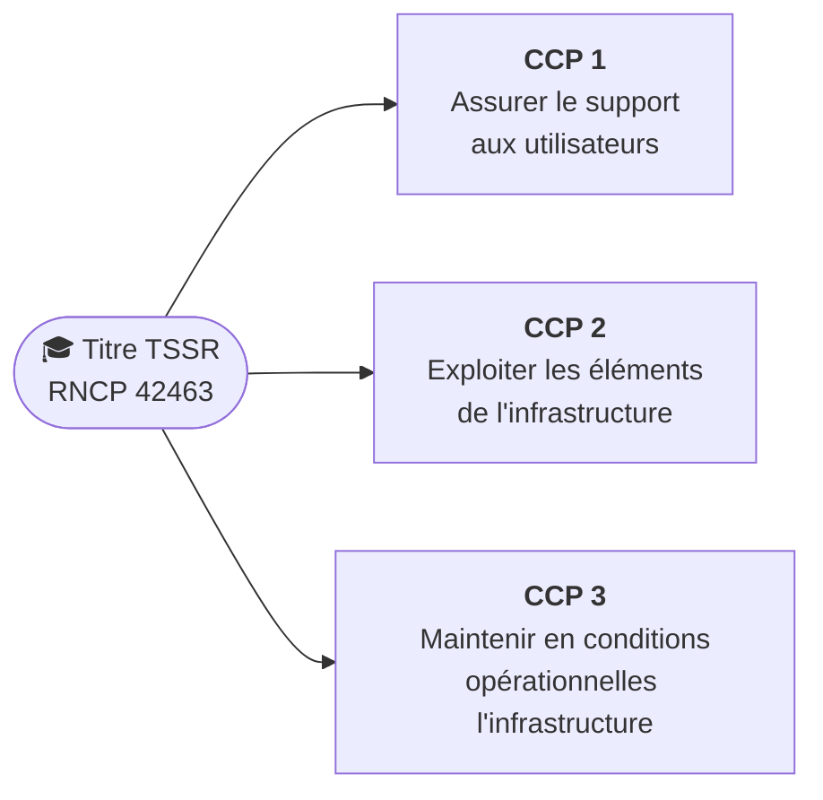

# Référentiel TSSR (REAC 2026)

Ce que le jury attend de toi le jour du titre, et **où le réviser sur ce site**.

!!! abstract "Quelle version te concerne ?"
    Le titre **Technicien supérieur systèmes et réseaux** (niveau 5, bac + 2) a été **révisé par l'arrêté du 16 juin 2026** (NOR : TRSD2612221A, *Journal officiel* n° 0142 du 19 juin 2026, texte 5). La nouvelle version, enregistrée sous le code **RNCP 42463** (fiche France Compétences), s'applique aux parcours **commencés à partir du 1ᵉʳ septembre 2026**, pour 5 ans (jusqu'au 31/08/2031).

    Ta formation a commencé le **12/10/2026** : c'est **cette version** qui s'applique. L'ancienne (arrêté du 26 avril 2023, RNCP 37682, 2 blocs) ne concerne que les parcours commencés avant. **Fais-le confirmer par ton centre (ENI)**, qui organise ta session d'examen.

## 🧭 Les 3 CCP et les 10 compétences

Le titre est découpé en **3 blocs**, chacun validé par un **CCP** (*certificat de compétences professionnelles*). Pour avoir le titre, il faut valider les 3.

| CCP | N° | Compétence |
|---|---|---|
| **1 · Assurer le support aux utilisateurs** | 1 | Exploiter l'**intelligence artificielle** et encadrer son usage |
| | 2 | Assurer le **déploiement des équipements numériques** et accompagner à l'utilisation des **outils collaboratifs** |
| | 3 | Apporter une **assistance technique** |
| **2 · Exploiter les éléments de l'infrastructure** | 4 | Exploiter un **réseau IP** |
| | 5 | Installer et assurer l'exploitation de **serveurs Windows et Linux** |
| | 6 | Exploiter des serveurs dans une **infrastructure virtualisée** |
| | 7 | Gérer les **accès et la sécurité** dans un environnement **hybride** |
| **3 · Maintenir en conditions opérationnelles** | 8 | Optimiser des **scripts** à l'aide de l'**intelligence artificielle** |
| | 9 | Assurer la **continuité et la reprise** de l'infrastructure |
| | 10 | **Mettre à jour et superviser** les éléments de l'infrastructure |

## 👔 Ce que le texte officiel attend du technicien

Le **résumé du référentiel d'emploi** (annexe de l'arrêté) décrit le métier. En plus des 10 compétences, il insiste sur des **attitudes professionnelles** que le jury peut évaluer, notamment pendant l'entretien :

| Le texte officiel dit… | Concrètement, à l'examen et en stage |
|---|---|
| Intégrer l'**IA** comme aide à l'analyse, au diagnostic et à l'optimisation, « dans le respect des exigences de sécurité, de conformité et de continuité de service » | Savoir **quand** l'utiliser et **quelles données** ne pas lui donner ([fiche IA](../revisions/fiche-ia.md)) |
| **Sensibiliser** aux bonnes pratiques de **sécurité**, d'**éthique** et de **sobriété numérique** | Expliquer simplement un risque (phishing, mot de passe, données personnelles) ; prolonger la vie du matériel, éteindre ce qui ne sert pas |
| Prendre en compte les utilisateurs **en situation de handicap** | Connaître les **outils d'accessibilité** de Windows (Loupe, Narrateur, contraste élevé, dictée) et adapter son accompagnement |
| **Qualifier** et traiter les demandes et incidents, appliquer les procédures de résolution et d'**escalade**, assurer la **traçabilité** | Ticket complet et clair (ITIL, GLPI : cours 6) ; savoir **quand passer la main** au niveau 2 |
| **Surveiller** l'infrastructure, **superviser** ses composants | Lire des alertes, des journaux, des indicateurs (CPU, disque, services) |
| Exploiter des environnements **sur site ou dans le cloud**, gérer les droits en environnement **hybride** | Comptes locaux et comptes cloud (Active Directory + Microsoft Entra ID) |
| **Rédiger la documentation** | Procédures, comptes rendus d'intervention, schémas réseau |
| Se tenir à jour : IA, cybersécurité, virtualisation, cloud, réseaux | Avoir une méthode de **veille** (sites, newsletters, CERT-FR) et pouvoir en parler à l'oral |
| Respecter les procédures, la **confidentialité** et la **conformité réglementaire** ; possibles **astreintes** et horaires décalés | Montrer que tu connais ces contraintes du métier |

**Emplois visés** (codes ROME **I1401** et **M1810**) : technicien systèmes et réseau, technicien support, technicien d'exploitation, technicien informatique, en ESN, DSI, collectivités, PME ou établissements de santé.

## 📝 Les épreuves

D'après la fiche officielle France Compétences (RNCP 42463), chaque CCP s'évalue par **3 épreuves** :

| CCP | Mise en situation professionnelle | Entretien technique | Questionnaire professionnel | Total |
|---|---|---|---|---|
| **1** | 2 h 15 : manipulations sur machines virtuelles, présentation orale, **incident traité devant le jury** | 30 min | 30 min | **3 h 15** |
| **2** | 2 h 15 : manipulations sur serveurs et clients virtuels, **incident réseau devant le jury** | 30 min | 45 min | **3 h 30** |
| **3** | 1 h 45 : manipulations et présentation orale (sans incident en direct) | 30 min | 45 min | **3 h** |

⚠️ Chaque questionnaire contient **au moins une question en anglais** : habitue-toi à lire la documentation technique en anglais (les pages `man`, l'aide PowerShell, Microsoft Learn).

📌 Il faut aussi rédiger ton **Dossier Professionnel (DP)**, qui décrit des situations réelles que tu as vécues, notamment en **stage** (du 05/04 au 28/05/2027). Commence à noter tes interventions dès maintenant.

## 🗺️ Où réviser chaque compétence sur ce site

D'après le [programme officiel de l'école](../programme/index.md) (MàJ 23/02/2026). ✅ = cours rédigé · ⏳ = à venir dans le planning

| N° | Compétence | Cours et fiches du site |
|---|---|---|
| 1 | IA et encadrement de son usage | ⏳ [Cours 12 · Automatisation et IA appliquées au support et au MCO](../cours/cours-12-automatisation-et-ia-appliquees-au-support-et-au-mco/index.md) (15/02/2027) · ✅ [Fiche « L'IA au service du technicien »](../revisions/fiche-ia.md) |
| 2 | Déploiement des équipements, outils collaboratifs | ✅ Semaine Microsoft 365 (12/10/2026) · ✅ [Cours 2](../cours/cours-02-systeme-client-microsoft/index.md) (installation, VMware, images et déploiement) · ⏳ [Cours 14 · Services Cloud](../cours/cours-14-services-cloud/index.md) |
| 3 | Assistance technique | ✅ [Cours 1, module 5](../cours/cours-01-bases-des-reseaux/module-5-les-premieres-commandes/index.md) (méthode de dépannage) · ✅ [Cours 2, modules 9-10](../cours/cours-02-systeme-client-microsoft/module-10-maintenance-du-systeme/index.md) · ⏳ [Cours 5](../cours/cours-05-mise-en-situation-professionnelle-systeme-client/index.md) (mise en situation) · ⏳ [Cours 6](../cours/cours-06-sensibilisation-itil-et-gestion-de-parc/index.md) (ITIL, GLPI) |
| 4 | Réseau IP | ✅ [Cours 1](../cours/cours-01-bases-des-reseaux/index.md) · ⏳ [Cours 7](../cours/cours-07-les-infrastructures-reseau/index.md) (switchs, VLAN, routage, ACL, NAT) · ⏳ [Cours 16](../cours/cours-16-reseau-et-securite/index.md) |
| 5 | Serveurs Windows et Linux | ✅ [Cours 3](../cours/cours-03-utilisateur-d-une-distribution-gnu-linux/index.md) · ✅ [Cours 4](../cours/cours-04-administration-d-une-distribution-gnu-linux/index.md) · ⏳ [Cours 8](../cours/cours-08-les-services-reseau-en-environnement-microsoft/index.md) (Windows Server, ADDS, GPO, DHCP, DNS) · ⏳ [Cours 9](../cours/cours-09-mise-en-situation-professionnelle-services-reseau/index.md) (mise en situation Microsoft et Linux) |
| 6 | Infrastructure virtualisée | ✅ [Cours 2, module 2bis](../cours/cours-02-systeme-client-microsoft/module-2bis-vmware-workstation/index.md) · ⏳ [Cours 13](../cours/cours-13-virtualisation-de-serveurs/index.md) (vSphere) · ⏳ [Cours 14 · Services Cloud](../cours/cours-14-services-cloud/index.md) |
| 7 | Accès et sécurité en environnement hybride | ✅ [Cours 2, modules 5-6-8](../cours/cours-02-systeme-client-microsoft/module-6-la-securite-ntfs-et-les-acl/index.md) · ✅ [Cours 4, modules 10-11](../cours/cours-04-administration-d-une-distribution-gnu-linux/module-11-droits-sur-les-fichiers-et-repertoires/index.md) · ⏳ [Cours 8](../cours/cours-08-les-services-reseau-en-environnement-microsoft/index.md) (ADDS, GPO) · ⏳ [Cours 14 · Services Cloud](../cours/cours-14-services-cloud/index.md) · ⏳ [Cours 16](../cours/cours-16-reseau-et-securite/index.md) (pare-feu, VPN, certificats) |
| 8 | Scripts optimisés avec l'IA | ✅ [Cours 2, modules 3 et 11](../cours/cours-02-systeme-client-microsoft/module-11-aller-plus-loin-avec-powershell/index.md) · ✅ [Cours 3, module 6](../cours/cours-03-utilisateur-d-une-distribution-gnu-linux/module-6-specificites-du-shell-bash/index.md) · ⏳ [Cours 10 · Bash](../cours/cours-10-initiation-au-scripting-bash/index.md) · ⏳ [Cours 11 · PowerShell](../cours/cours-11-initiation-a-powershell/index.md) · ⏳ [Cours 12 · Automatisation et IA](../cours/cours-12-automatisation-et-ia-appliquees-au-support-et-au-mco/index.md) |
| 9 | Continuité et reprise | ✅ [Cours 2, module 10](../cours/cours-02-systeme-client-microsoft/module-10-maintenance-du-systeme/index.md) (WinRE, restauration) · ✅ [Cours 4, modules 4 et 12](../cours/cours-04-administration-d-une-distribution-gnu-linux/module-4-debian-en-mode-maintenance/index.md) · ⏳ [Cours 15](../cours/cours-15-sauvegarde-et-restauration/index.md) (sauvegarde, sauvegarde des VM) |
| 10 | Mises à jour et supervision | ✅ [Cours 2, module 1](../cours/cours-02-systeme-client-microsoft/module-1-les-systemes-d-exploitation-et-microsoft-windows-10/index.md) · ✅ [Cours 4, modules 6 et 12](../cours/cours-04-administration-d-une-distribution-gnu-linux/module-12-maintenance-d-un-systeme-en-production/index.md) · ⏳ [Cours 15](../cours/cours-15-sauvegarde-et-restauration/index.md) (superviser les sauvegardes) · ⏳ [Cours 16](../cours/cours-16-reseau-et-securite/index.md) (journalisation centralisée) · ⏳ [Cours 17 · Supervision](../cours/cours-17-supervision/index.md) |

✅ **Bonne nouvelle** : le programme ENI de 2026 a été adapté au nouveau référentiel. Il ajoute un cours **Automatisation et IA** (cours 12), un cours **Services Cloud** (cours 14) et un cours **Supervision** (cours 17) : les 10 compétences ont toutes un cours correspondant.

## ⚠️ Points de vigilance par rapport au programme

Quelques sujets **évalués à l'examen** restent peu visibles dans les intitulés des cours :

| Sujet du REAC | Constat | Que faire ? |
|---|---|---|
| **Services réseau sous Linux** (compétence 5) | Plus de cours dédié en 2026, alors que la mise en situation du 25/01 demande des « services réseaux en environnement Linux » | Demander où ils seront vus ; revoir le [cours 4](../cours/cours-04-administration-d-une-distribution-gnu-linux/index.md) (réseau, paquets, services avec `systemctl`) |
| **Environnement hybride** (compétence 7) | Le cours Services Cloud n'est pas détaillé | Retenir le principe : les comptes Active Directory locaux sont **synchronisés** vers le cloud (Microsoft Entra ID, avec l'outil **Entra Connect**) |
| **Continuité et reprise** (compétence 9) | Le cours 15 parle de sauvegarde ; le REAC parle aussi de **reprise d'activité** | Connaître les sigles **PCA** (plan de continuité), **PRA** (plan de reprise), **RPO** (données qu'on accepte de perdre) et **RTO** (durée d'arrêt acceptable) |
| **Déploiement de masse** (compétence 2) | Le cours RDS / WDS / MDT a disparu du programme | Revoir le [cours 2, module 12](../cours/cours-02-systeme-client-microsoft/module-12-introduction-a-la-capture-et-au-deploiement-d-images/index.md) (sysprep, images, PXE) |
| **Anglais technique** | Une question en anglais dans chaque questionnaire | Lire régulièrement la documentation en anglais |
| **Sobriété numérique, éthique, accessibilité** | Citées dans le texte officiel, absentes des intitulés des cours | Savoir donner 2 ou 3 exemples concrets pour chacune (voir le tableau plus haut) |
| **Veille technologique** et **documentation** | Attendues par le texte, pas de cours dédié | Tenir un petit journal de veille et soigner tes comptes rendus de TP : ils serviront pour le Dossier Professionnel |

## 🔁 Si tu avais déjà des CCP de l'ancien titre

L'article 4 de l'arrêté prévoit une **correspondance** avec le titre de 2023 (sur demande auprès de la DREETS) :

| Ancien CCP (arrêté du 26/04/2023) | Nouveaux CCP (arrêté du 16/06/2026) |
|---|---|
| Exploiter les éléments de l'infrastructure et assurer le support aux utilisateurs | CCP 1 « Assurer le support aux utilisateurs » **et** CCP 2 « Exploiter les éléments de l'infrastructure » |
| Maintenir l'infrastructure et contribuer à son évolution et à sa sécurisation | CCP 3 « Maintenir en conditions opérationnelles l'infrastructure » |

L'article 5 prévoit aussi une équivalence avec le titre « Administrateur de systèmes d'information sécurisés » du ministère des Armées.

## 📚 Sources officielles

- [Arrêté du 16 juin 2026 relatif au titre professionnel de technicien supérieur systèmes et réseaux](https://www.legifrance.gouv.fr/jorf/id/JORFTEXT000054273839) — *Journal officiel* n° 0142 du 19 juin 2026, texte 5 (NOR : TRSD2612221A)
- Le référentiel complet (REAC) et le référentiel d'évaluation sont publiés sur [travail-emploi.gouv.fr](https://travail-emploi.gouv.fr) (article 2 de l'arrêté)
- [Fiche RNCP 42463 (France Compétences)](https://www.francecompetences.fr/recherche/rncp/42463/), avec le *référentiel d'activités, de compétences et d'évaluation* en téléchargement
- Pour comparaison, l'ancienne version : [arrêté du 26 avril 2023 (Légifrance)](https://www.legifrance.gouv.fr/jorf/id/JORFTEXT000047541115)
