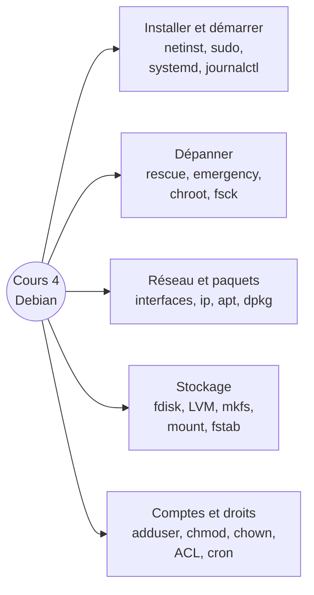

# Fiche · Administration d'une distribution GNU/Linux

*Cours lié : [Cours 4 - Administration d'une distribution GNU/Linux](../cours/cours-04-administration-d-une-distribution-gnu-linux/index.md) · 16/11 → 27/11/2026 · 70 h*

## 🗺️ La carte du cours

## 📝 L'essentiel

| Commande | À retenir |
| --- | --- |
| `systemctl status / restart / enable --now` | État / redémarrer / activer et démarrer un service |
| `journalctl -u ssh` · `-p err --since today` | Journal d'un service · erreurs du jour |
| `/etc/network/interfaces` | Configuration IP, puis `systemctl restart networking` |
| `ip a` · `ip r` · `ss -tulpn` | Adresses · routes · ports en écoute |
| `apt update && apt upgrade` | Rafraîchir puis mettre à jour |
| `apt purge` | Supprimer avec la configuration |
| `lsblk` · `blkid` · `df -h` | Disques · UUID · place libre |
| `pvcreate` → `vgcreate` → `lvcreate` | Disque → groupe de volumes → volume logique |
| `lvextend -r -L +2G` | Agrandir un LV **et** son système de fichiers |
| `/etc/fstab` + `mount -a` | Montages au démarrage, à tester avant de redémarrer |
| `usermod -aG groupe user` | Ajouter à un groupe **sans** retirer les autres |
| `chmod 750` · `chown user:groupe` | Droits rwx (4-2-1) · propriétaire |
| `30 2 * * *` | Cron : tous les jours à 2 h 30 |

## ✅ Points clés

- Debian **stable** pour les serveurs ; on travaille avec `sudo`, pas en root.
- Mot de passe root perdu : GRUB → `init=/bin/bash` → `mount -o remount,rw /` → `passwd root`.
- `fsck` uniquement sur une partition **démontée**.
- Dans fstab, on identifie les disques par **UUID**.
- `usermod -G` **sans** `-a` remplace tous les groupes de l'utilisateur.

## 🧠 Quiz express

