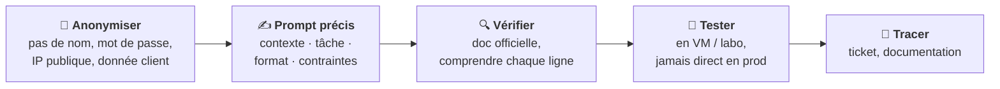

# Fiche · L'IA au service du technicien

*Référentiel : [REAC TSSR 2026](../referentiel/index.md), compétences 1 (« Exploiter l'intelligence artificielle et encadrer son usage ») et 8 (« Optimiser des scripts à l'aide de l'intelligence artificielle »).*

!!! abstract "En clair"
    Une **IA générative** (ChatGPT, Microsoft Copilot, Mistral Le Chat, Claude…) répond à une question écrite en langage naturel (un **prompt**). Pour un technicien, c'est un **assistant** très utile : expliquer une erreur, rédiger une réponse, proposer un script. Mais elle peut **se tromper avec aplomb**, et tout ce qu'on lui envoie peut **sortir de l'entreprise**. Le REAC demande donc deux choses : savoir **l'utiliser**, et savoir **l'encadrer**.

## 🖼️ Résumé visuel

**La bonne façon d'utiliser une IA**



## 1. Ce que l'IA fait bien pour un technicien

| Usage | Exemple de demande |
|---|---|
| **Expliquer** un message d'erreur | « Que signifie l'erreur Windows 0x80070005 lors d'une mise à jour ? » |
| **Rédiger** une réponse claire à un utilisateur | « Reformule cette procédure pour une utilisatrice qui débute, en 5 étapes » |
| **Résumer** un long ticket ou un journal | « Résume ce ticket en 3 lignes : problème, cause, solution » |
| **Traduire** une documentation en anglais | « Traduis et explique ce paragraphe de la doc Microsoft » |
| **Proposer** un script ou une commande | « Écris un script PowerShell qui liste les comptes AD inactifs depuis 90 jours » |
| **Améliorer** un script existant | « Ajoute la gestion des erreurs et des commentaires à ce script » |
| **Rédiger** une documentation | « Transforme mes notes en procédure avec titres et étapes numérotées » |

## 2. Les risques à connaître

| Risque | Ce que ça veut dire | Exemple |
|---|---|---|
| **Hallucination** | L'IA **invente** une réponse fausse mais crédible | Une option de commande qui n'existe pas, un paramètre PowerShell imaginaire |
| **Fuite de données** | Ce qu'on colle dans une IA publique peut être **conservé** ou réutilisé | Coller un fichier client, un mot de passe, la configuration du pare-feu |
| **Non-conformité RGPD** | Envoyer des **données personnelles** à un service externe sans base légale | Coller la liste des salariés avec leurs adresses |
| **Script dangereux** | Une commande proposée peut **supprimer** ou **casser** | Un `Remove-Item -Recurse` ou un `rm -rf` mal placé |
| **« Shadow AI »** | Des salariés utilisent des IA **non validées** par l'entreprise | Un service qui traduit ses contrats dans une IA gratuite |

## 3. Encadrer l'usage (le rôle du technicien)

- **Respecter la charte** informatique de l'entreprise et n'utiliser que les **outils d'IA validés** par la DSI.
- **Ne jamais saisir** : mots de passe, clés, données personnelles, informations clients, configurations sensibles. **Anonymiser** (`srv-xxx`, `utilisateur1`, `192.0.2.10`).
- **Sensibiliser les utilisateurs** : ce qu'ils peuvent ou non coller dans une IA, et pourquoi vérifier les réponses.
- **Connaître le cadre légal** : le **RGPD** (données personnelles) et le **règlement européen sur l'IA** (*AI Act*), qui impose depuis février 2025 que le personnel qui utilise l'IA ait une **maîtrise suffisante** de ces outils.
- **Tracer** : noter dans le ticket ou la documentation qu'une solution vient d'une IA et a été **vérifiée**.

## 4. Écrire un bon prompt

Un prompt efficace donne **4 éléments** :

| Élément | Exemple |
|---|---|
| **Contexte** | « Je suis technicien support. Parc Windows 11, domaine Active Directory. » |
| **Tâche** | « Écris un script PowerShell qui liste les ordinateurs du domaine qui ne se sont pas connectés depuis 60 jours. » |
| **Format** | « Donne le script commenté, puis explique chaque bloc en une phrase. » |
| **Contraintes** | « Il ne doit rien supprimer ni modifier, seulement afficher et exporter en CSV. » |

## 5. Optimiser un script avec l'IA, sans danger

1. **Donner le script** (anonymisé) et dire ce qu'on veut : plus lisible, plus rapide, avec gestion d'erreurs, avec journalisation.
2. **Lire et comprendre chaque ligne** proposée : si une commande est inconnue, vérifier avec `Get-Help` ou `man`.
3. **Tester d'abord en lecture seule** : en PowerShell, le paramètre **`-WhatIf`** montre ce qui *serait* fait, sans rien faire.
4. **Tester dans une VM** ou un labo, jamais directement en production.
5. **Garder une version** de l'ancien script (et l'historique, idéalement avec Git).

```powershell
# Avant d'exécuter pour de vrai un script proposé par une IA :
Get-ChildItem C:\Temp -Recurse | Remove-Item -WhatIf    # affiche ce qui SERAIT supprimé, sans rien supprimer
```

## ✅ À retenir

- L'IA est un **assistant**, pas une source fiable : **vérifier, comprendre, tester**.
- **Jamais** de données personnelles, de mots de passe ou d'informations confidentielles dans une IA non validée (**RGPD**, charte).
- Un bon prompt : **contexte + tâche + format + contraintes**.
- Scripts : relire chaque ligne, **`-WhatIf`**, test en **VM**, sauvegarde de l'ancienne version.
- Le technicien **sensibilise** les utilisateurs et **trace** l'usage de l'IA.

??? question "1. Un utilisateur veut coller le fichier Excel des salaires dans une IA gratuite pour faire un graphique. Que lui réponds-tu ?"
    **Non** : ce sont des **données personnelles** et **confidentielles**. Les envoyer à un service externe non validé est contraire au **RGPD** et à la charte. Proposer un outil validé par l'entreprise, ou faire le graphique dans Excel.

??? question "2. Une IA te propose un script qui supprime des fichiers. Quelles étapes avant de l'exécuter en production ?"
    Le **lire** et comprendre chaque ligne → le lancer avec **`-WhatIf`** → le **tester dans une VM** → garder une **sauvegarde** → seulement ensuite, l'exécuter en production.

??? question "3. L'IA cite un paramètre « -ForceClean » pour une cmdlet. Comment vérifier ?"
    `Get-Help NomDeLaCmdlet -Full` ou la documentation **Microsoft Learn** : si le paramètre n'y figure pas, c'est probablement une **hallucination**.
