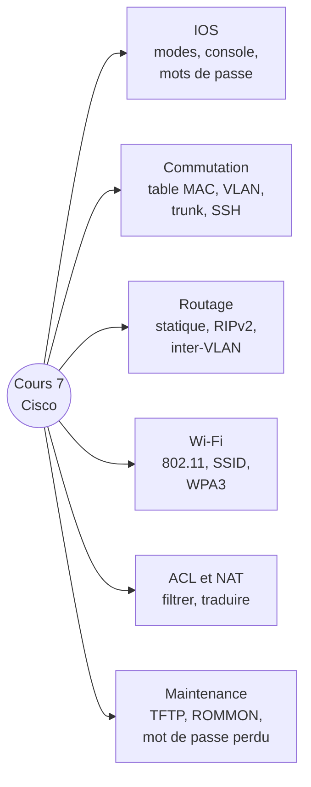

# Fiche · Les infrastructures réseau

*Cours lié : [Cours 7 - Les infrastructures réseau](../cours/cours-07-les-infrastructures-reseau/index.md) · 21/12/2026 → 08/01/2027 · 63 h*

## 🗺️ La carte du cours

## 📝 L'essentiel

| Notion | À retenir |
| --- | --- |
| **Modes IOS** | `>` utilisateur → `enable` → `#` privilégié → `conf t` → `(config)#` |
| **Enregistrer** | `copy running-config startup-config` (RAM → NVRAM) |
| **`enable secret`** | Mot de passe privilégié haché |
| **VLAN** | 1 à 4094 · `switchport mode access` + `switchport access vlan 10` |
| **Trunk 802.1Q** | `switchport mode trunk` · VLAN natif identique des deux côtés |
| **SSH** | `ip domain-name` + `crypto key generate rsa` + `login local` + `transport input ssh` |
| **Route statique** | `ip route réseau masque saut-suivant` · défaut `0.0.0.0 0.0.0.0` |
| **Distance administrative** | Connecté 0 · statique 1 · OSPF 110 · RIP 120 |
| **Inter-VLAN** | Router-on-a-stick (`encapsulation dot1Q`) ou switch L3 (`ip routing`) |
| **Wi-Fi** | Wi-Fi 6 = 802.11ax · WPA3 recommandé · 802.1X en entreprise |
| **ACL** | Standard (source) près de la destination · étendue près de la source · `deny any` implicite |
| **Wildcard** | `0.0.0.255` pour un /24 |
| **PAT** | `ip nat inside/outside` + ACL + `ip nat inside source list … overload` |
| **Mot de passe perdu** | Ctrl+Pause → `confreg 0x2142` → `copy start run` → nouveau mot de passe → `0x2102` |

## ✅ Points clés

- Toujours **enregistrer** après une modification validée : la running-config est perdue à l'extinction.
- Les interfaces d'un **routeur** sont éteintes par défaut : `no shutdown`.
- Une route statique se pense **aller et retour** : chaque routeur doit connaître le chemin.
- Une ACL est lue **de haut en bas**, et sans `permit` final elle bloque tout.
- Vérifier avec les `show` : `show vlan brief`, `show interfaces trunk`, `show ip route`, `show access-lists`, `show ip nat translations`.

## 🧠 Quiz express

