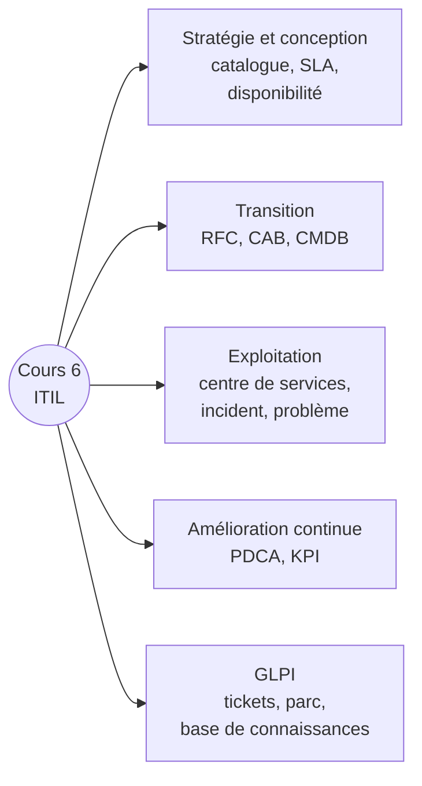

# Fiche · ITIL et gestion de parc

*Cours lié : [Cours 6 - Sensibilisation ITIL et gestion de parc](../cours/cours-06-sensibilisation-itil-et-gestion-de-parc/index.md) · 07/12 → 18/12/2026 · 70 h*

## 🗺️ La carte du cours

## 📝 L'essentiel

| Notion | À retenir |
| --- | --- |
| **ITIL** | Bonnes pratiques de gestion des services informatiques |
| **Cycle de vie** | Stratégie → Conception → Transition → Exploitation → Amélioration continue |
| **Valeur** | Utilité **et** garantie |
| **SLA / OLA / UC** | Engagement envers le client / contrat interne / contrat avec un sous-traitant |
| **RACI** | Réalise, Assume (un seul), Consulté, Informé |
| **Requête** | Une demande, pas une panne |
| **Incident** | Service arrêté ou dégradé → **rétablir** vite |
| **Problème** | **Cause** inconnue d'incidents qui se répètent |
| **Erreur connue** | Cause connue + contournement (KEDB) |
| **Priorité** | Impact × urgence |
| **RFC** | Demande de changement : standard / normal (CAB) / urgent (ECAB) |
| **CMDB** | Base des éléments de configuration (CI) et de leurs liens |
| **Escalade** | Fonctionnelle (plus expert) / hiérarchique (responsable) |
| **Ticket GLPI** | Nouveau → En cours → En attente → Résolu → **Clos** (validé par le demandeur) |

## ✅ Points clés

- Le **centre de services** est le **point de contact unique** des utilisateurs.
- Incident = rétablir le service ; problème = trouver la **cause** pour que ça ne revienne pas.
- PDCA : **Plan, Do, Check, Act** ; on mesure avec des **KPI** par rapport aux SLA.
- Savoir-être : **écoute active**, reformuler, ne pas couper la parole.
- Chaque solution trouvée alimente la **base de connaissances**.

## 🧠 Quiz express

