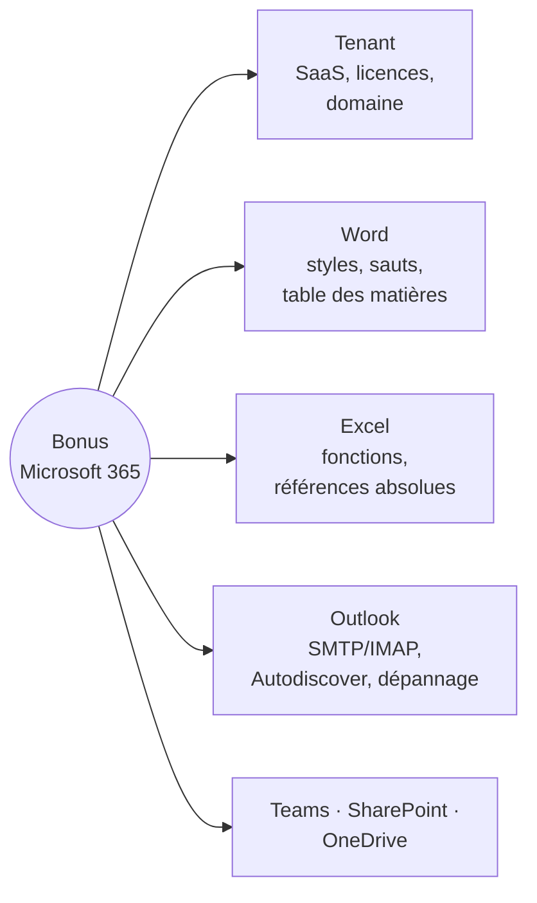

# Fiche · Microsoft 365

*Cours lié : [Bonus - Microsoft 365](../cours/bonus-microsoft-365/index.md)*

## 🗺️ La carte du cours

## 📝 L'essentiel

| Notion | À retenir |
| --- | --- |
| **SaaS** | Logiciel hébergé par le fournisseur, payé par abonnement |
| **Tenant** | `nom.onmicrosoft.com`, non modifiable ; administrateur global |
| **Licence** | Attribuée **par utilisateur** |
| **Domaine personnalisé** | Vérifié par un enregistrement **TXT**, puis MX, CNAME autodiscover |
| **Word** | Styles Titre X → table des matières ; saut de section pour changer la mise en page |
| **Excel** | `=SI()`, `=RECHERCHEV(…;FAUX)`, `$A$1` avec `F4` |
| **SMTP** | Envoi : 25 entre serveurs, 587 soumission |
| **IMAP / POP** | 993 sur le serveur / 995 téléchargé |
| **Autodiscover** | Outlook se configure avec la seule adresse mail |
| **.ost / .pst** | Cache Exchange reconstructible / données locales à sauvegarder |
| **Dépanner Outlook** | Webmail → `outlook.exe /safe` → SCANPST → nouveau profil |
| **OneDrive / SharePoint** | Mes fichiers / les fichiers de l'équipe |
| **Équipe Teams** | Crée un groupe M365, un site SharePoint, une boîte partagée, un OneNote |

## ✅ Points clés

- Sans **licence**, un utilisateur n'a ni boîte mail ni applications.
- Si le **webmail** fonctionne, le problème est sur le **poste**, pas sur le compte.
- Le fichier **.pst** contient les seules copies des mails : on ne le supprime pas.
- Les fichiers d'une équipe Teams sont dans **SharePoint**, un dossier par canal.
- **Historique des versions** et **corbeille** pour récupérer un fichier écrasé ou supprimé.

## 🧠 Quiz express

