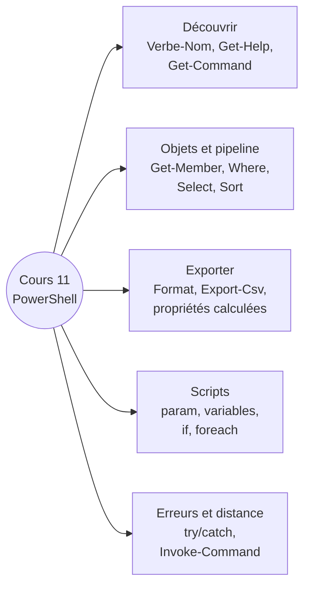

# Fiche · PowerShell

*Cours lié : [Cours 11 - Initiation à PowerShell](../cours/cours-11-initiation-a-powershell/index.md) · 08/02 → 12/02/2027 · 35 h*

## 🗺️ La carte du cours

## 📝 L'essentiel

| Notion | À retenir |
| --- | --- |
| **Versions** | 5.1 `powershell.exe` (Windows) / 7 `pwsh` (multiplateforme) |
| **Cmdlet** | Verbe-Nom au singulier : `Get-Service` |
| **Trouver / aide** | `Get-Command *mot*` · `Get-Help cmd -Examples` |
| **Objet** | Propriétés + méthodes : `cmd` **\|** `Get-Member` |
| **Filtrer / choisir** | `Where-Object { $_.Status -eq 'Running' }` · `Select-Object Name, Id` |
| **Trier / compter** | `Sort-Object -Descending` · `Measure-Object -Sum` |
| **Exporter** | `Export-Csv -Delimiter ";" -NoTypeInformation` · `Import-Csv` |
| **Propriété calculée** | `@{ n='Mo'; e={ $_.Length / 1MB } }` |
| **Variables** | `$nom = valeur` · `Read-Host` · `$env:COMPUTERNAME` |
| **Tableau** | `$t = "a","b"` · `$t += "c"` · `$t[0]` |
| **Contrôle** | `if () {} elseif () {} else {}` · `foreach ($x in $liste) {}` · `switch` |
| **Paramètres** | `param([Parameter(Mandatory=$true)][string]$Nom)` |
| **Erreurs** | `try {} catch { $_.Exception.Message } finally {}` · `-ErrorAction Stop` |
| **À distance** | `Enter-PSSession` · `Invoke-Command -ComputerName A,B -ScriptBlock {}` |

## ✅ Points clés

- PowerShell manipule des **objets**, pas du texte : on filtre sur des **propriétés**.
- **Filtrer tôt** (`Where-Object`), **formater à la fin** (`Format-Table` ne s'exporte pas).
- Scripts bloqués : `Set-ExecutionPolicy RemoteSigned` (en administrateur).
- Pour qu'une erreur soit attrapée par `catch`, elle doit être **bloquante** : `-ErrorAction Stop`.
- À distance, une variable locale s'utilise avec `$Using:variable`.

## 🧠 Quiz express

