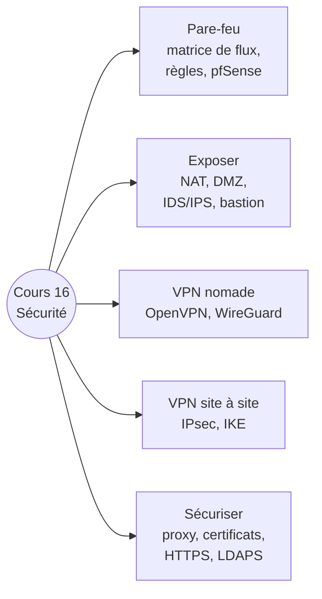

# Fiche · Réseau et sécurité

*Cours lié : [Cours 16 - Réseau et sécurité](../cours/cours-16-reseau-et-securite/index.md) · 15/03 → 26/03/2027 · 70 h*

## 🗺️ La carte du cours

## 📝 L'essentiel

| Notion | À retenir |
| --- | --- |
| **Matrice de flux** | Source, destination, port, action : avant toute règle |
| **Règles** | Lues de haut en bas, la première qui correspond gagne ; refus par défaut |
| **Block / reject** | Bloquer en silence / en prévenant l'émetteur |
| **Redirection de port** | IP WAN:443 → serveur interne:443 |
| **DMZ** | Zone des services exposés ; DMZ → LAN interdit |
| **IDS / IPS** | Détecte et alerte / détecte et bloque |
| **VPN** | Tunnel chiffré et authentifié |
| **OpenVPN / WireGuard** | Certificats, UDP 1194 / paires de clés, UDP 51820 |
| **IPsec** | Phase 1 IKE (UDP 500/4500) puis phase 2 (réseaux, ESP) |
| **Proxy Squid** | Port 3128, cache, filtrage, journaux conservés 1 an |
| **Asymétrique** | Clé publique diffusée, clé privée jamais partagée |
| **Certificat** | Clé publique + nom + signature d'une autorité |
| **TLS** | 1.2 et 1.3 seulement |
| **LDAPS** | Port 636 (LDAP en clair : 389) |

## ✅ Points clés

- Jamais de **RDP** ou de **SMB** directement exposé sur Internet : VPN ou bastion.
- PPTP est **obsolète** ; le réseau du tunnel ne doit chevaucher **aucun** autre réseau.
- En IPsec, les deux côtés sont des **miroirs** : mêmes algorithmes, réseaux local/distant inversés.
- Alerte de certificat : CA non approuvée, **nom** différent, certificat **expiré** ou chaîne incomplète.
- Apache : `a2enmod ssl`, `a2ensite`, puis **`apache2ctl configtest`** avant le reload.

## 🧠 Quiz express

