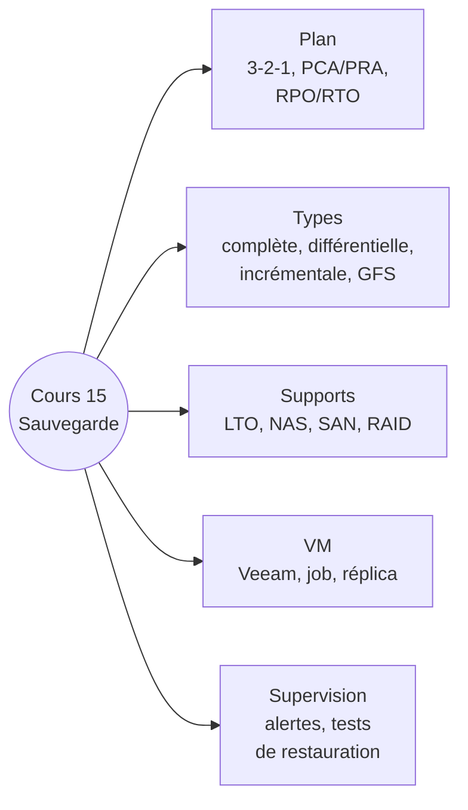

# Fiche · Sauvegarde et restauration

*Cours lié : [Cours 15 - Sauvegarde et restauration](../cours/cours-15-sauvegarde-et-restauration/index.md) · 08/03 → 12/03/2027 · 35 h*

## 🗺️ La carte du cours

## 📝 L'essentiel

| Notion | À retenir |
| --- | --- |
| **3-2-1** | 3 copies, 2 supports différents, 1 hors site |
| **PCA / PRA** | Continuer l'activité pendant la crise / redémarrer le SI |
| **RPO / RTO** | Perte de données acceptable / durée d'arrêt acceptable |
| **Complète** | Tout ; restauration la plus simple |
| **Différentielle** | Depuis la dernière **complète** → restaurer : complète + **dernière** différentielle |
| **Incrémentale** | Depuis la dernière **sauvegarde** → restaurer : complète + **toutes** les incrémentales |
| **GFS** | Fils (jour), Père (semaine), Grand-père (mois) |
| **À chaud / à froid** | Sans / avec arrêt du service |
| **LTO** | Bande, grande capacité, **hors ligne** (protège des rançongiciels) |
| **RAID** | 0 vitesse · 1 miroir · 5 parité (3 disques) · 10 (4 disques) ; **pas** une sauvegarde |
| **MySQL** | `mysqldump base > f.sql` / `mysql base < f.sql` |
| **Veeam** | Job (VM, dépôt, rétention), restauration granulaire, réplica |
| **VSS** | Sauvegarde cohérente des fichiers ouverts sous Windows |

## ✅ Points clés

- Une sauvegarde **non testée** ne vaut rien : tester régulièrement la **restauration**, noter le résultat et la durée.
- Une copie **hors ligne** ou **hors site** protège d'un rançongiciel ou d'un incendie.
- Vérifier **chaque jour** l'état des travaux (succès, avertissement, échec) et l'espace des dépôts.
- Utiliser un **compte de service dédié** pour les sauvegardes.
- Le RPO fixe la **fréquence** des sauvegardes, le RTO le **moyen** de reprise (réplica, restauration…).

## 🧠 Quiz express

