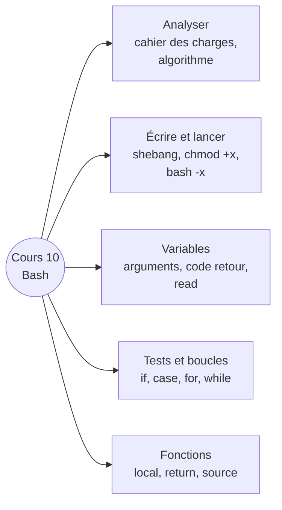

# Fiche · Scripting Bash

*Cours lié : [Cours 10 - Initiation au scripting Bash](../cours/cours-10-initiation-au-scripting-bash/index.md) · 01/02 → 05/02/2027 · 35 h*

## 🗺️ La carte du cours

## 📝 L'essentiel

| Notion | À retenir |
| --- | --- |
| **Shebang** | `#!/bin/bash` en première ligne |
| **Lancer** | `chmod +x script.sh` puis `./script.sh` |
| **Déboguer** | `bash -x script.sh` (trace) · `bash -n` (syntaxe) |
| **Variable** | `nom=valeur` (sans espace) · lire avec `"$nom"` |
| **Arguments** | `$1`… · `$#` nombre · `$@` tous · `$0` le script |
| **Code retour** | `$?` : 0 = succès · `exit n` |
| **Saisie** | `read -p "Question : " var` |
| **Enchaîner** | `&&` si succès · **\|\|** si échec · `;` toujours |
| **Test** | `if [[ $a -gt 5 ]] ; then … fi` (espaces obligatoires) |
| **Nombres / chaînes** | `-eq -ne -gt -lt` / `=`, `!=`, `-z` (vide) |
| **Fichiers** | `-f` fichier · `-d` dossier · `-e` existe |
| **Boucles** | `for x in liste ; do … done` · `while read l ; do … done < f` |
| **Calcul** | `$(( a + b ))` |
| **Fonction** | `func_nom() { local v=$1 ; … ; return 0 ; }` |

## ✅ Points clés

- On **analyse** avant d'écrire : entrées, sorties, erreurs, algorithme.
- Toujours mettre les variables **entre guillemets** : `"$var"`.
- Une fonction se déclare **avant** d'être appelée.
- Lire un CSV : `while IFS=";" read a b ; do … done < fichier.csv`.
- Un script propre **vérifie ses arguments** et sort avec un code d'erreur s'il en manque.

## 🧠 Quiz express

