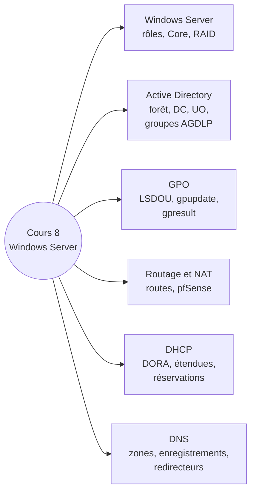

# Fiche · Services réseau en environnement Microsoft

*Cours lié : [Cours 8 - Les services réseau en environnement Microsoft](../cours/cours-08-les-services-reseau-en-environnement-microsoft/index.md) · 11/01 → 22/01/2027 · 70 h*

## 🗺️ La carte du cours

## 📝 L'essentiel

| Notion | À retenir |
| --- | --- |
| **Rôle** | `Install-WindowsFeature Nom -IncludeManagementTools` |
| **RAID 1 / 5** | Miroir / 3 disques minimum, supporte la panne d'un disque |
| **AD DS** | DNS pour localiser, LDAP pour interroger, Kerberos pour authentifier |
| **AGDLP** | Comptes → groupe Global → groupe Domaine Local → Permissions |
| **FSMO** | 5 rôles : 2 de forêt, 3 de domaine |
| **LSDOU** | Ordre d'application des GPO : Locale, Site, Domaine, UO (la dernière gagne) |
| **GPO** | `gpmc.msc` · `gpupdate /force` · `gpresult /r` |
| **Route par défaut** | `0.0.0.0/0` · `route print` |
| **NAT / PAT** | IP privée → IP publique / plusieurs machines distinguées par le port |
| **DORA** | Discover, Offer, Request, Ack · UDP 67/68 |
| **Options DHCP** | 003 passerelle · 006 DNS · 015 domaine |
| **Agent relais** | Transmet le DHCP à un serveur d'un autre réseau |
| **DNS** | Cache → hosts → serveur · port 53 |
| **Enregistrements** | A, AAAA, CNAME (alias), MX (mail), PTR (inverse), SRV (services AD) |

## ✅ Points clés

- **Deux contrôleurs de domaine** au minimum ; le DNS de l'AD est indispensable.
- Un serveur DHCP Windows doit être **autorisé dans l'AD** pour distribuer des adresses.
- Haute disponibilité DHCP : règle **80/20** ou **basculement**.
- Une GPO **Ordinateur** s'applique au démarrage, une GPO **Utilisateur** à l'ouverture de session.
- **Bloquer l'héritage** sur une UO ; une liaison **Appliquée** passe outre ce blocage.

## 🧠 Quiz express

