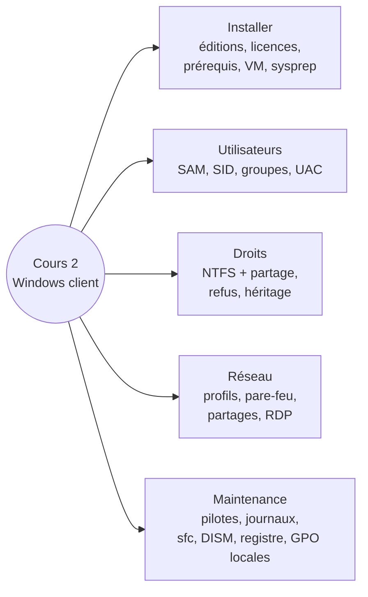

# Fiche · Système client Microsoft

*Cours lié : [Cours 2 - Système client Microsoft](../cours/cours-02-systeme-client-microsoft/index.md) · 26/10 → 06/11/2026 · 70 h*

## 🗺️ La carte du cours

## 📝 L'essentiel

| Notion | À retenir |
| --- | --- |
| **Édition Pro** | Minimum pour joindre un domaine |
| **Prérequis Windows 11** | 4 Go · 64 Go · UEFI/Secure Boot · TPM 2.0 |
| **MBR / GPT** | BIOS, 4 partitions, 2,2 To / UEFI, 128 partitions |
| **NTFS / FAT32 / exFAT** | Droits ACL / fichiers de 4 Go max / sans limite de 4 Go |
| **SID** | Identifiant unique d'un compte |
| **NTFS + partage** | Le plus restrictif gagne ; dans NTFS les droits se cumulent, le refus gagne |
| **Couper-coller même disque** | Seul cas où les droits sont conservés |
| **UNC** | `\\serveur\partage` · `$` = partage caché |
| **APIPA** | 169.254.x.x = pas de DHCP |
| **RDP** | TCP 3389, `mstsc`, NLA |
| **Réparer Windows** | `sfc /scannow` · `DISM /Online /Cleanup-Image /RestoreHealth` · `chkdsk C: /f` |
| **sysprep** | `/generalize /oobe /shutdown` avant de capturer un master |
| **HKLM / HKCU** | Registre de la machine / de l'utilisateur |
| **GPO locales** | `gpedit.msc` · `gpupdate /force` · `gpresult /r` |

## ✅ Points clés

- Bonne pratique de partage : **Utilisateurs authentifiés = Contrôle total** sur le partage, les vrais droits dans **NTFS**.
- Un **refus explicite** l'emporte toujours sur une autorisation ; être absent de la liste = refusé.
- Profils réseau : **Domaine** (automatique), **Privé** (confiance), **Public** (le plus strict, par défaut).
- Diagnostic : `eventvwr.msc` (journaux), `perfmon /rel` (fiabilité), `resmon` (ressources).
- Avant une manipulation risquée : **point de restauration** (`sysdm.cpl`) ou **snapshot** de la VM.

## 🧠 Quiz express

