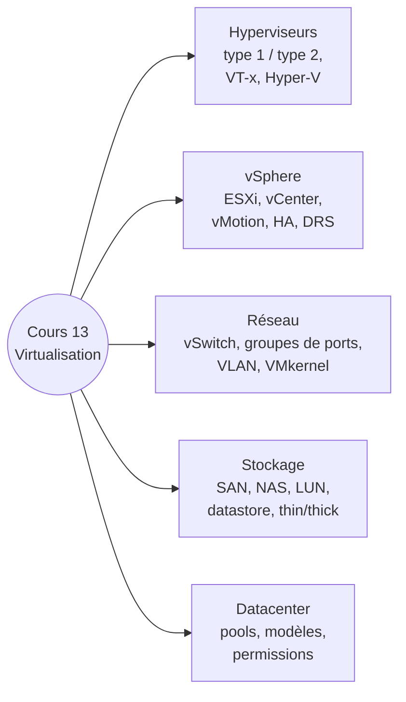

# Fiche · Virtualisation de serveurs

*Cours lié : [Cours 13 - Virtualisation de serveurs](../cours/cours-13-virtualisation-de-serveurs/index.md) · 22/02 → 26/02/2027 · 35 h*

## 🗺️ La carte du cours

## 📝 L'essentiel

| Notion | À retenir |
| --- | --- |
| **Type 1 / type 2** | Sur le matériel (ESXi, Hyper-V, KVM) / sur un OS (Workstation, VirtualBox) |
| **VT-x / AMD-V** | Virtualisation processeur, à activer dans le BIOS |
| **Commutateurs Hyper-V** | Externe (réseau physique) · Interne (hôte + VM) · Privé (VM seules) |
| **Point de contrôle / snapshot** | Retour en arrière, **pas** une sauvegarde |
| **ESXi / vCenter** | L'hyperviseur / la gestion centralisée (appliance VCSA) |
| **vMotion / Storage vMotion** | Déplacer une VM / ses disques **à chaud** |
| **HA / FT / DRS** | Redémarrage sur un autre hôte / copie en direct sans coupure / équilibrage de charge |
| **VLAN** | ID 1 à 4094, étiquette 802.1Q ; port access / trunk |
| **VMkernel** | Trafic de l'hôte : gestion, vMotion, iSCSI |
| **SAN / NAS** | Mode bloc (FC, iSCSI) / mode fichier (NFS, SMB) |
| **Datastore** | VMFS (sur LUN) ou NFS |
| **Thick / thin** | Espace réservé d'avance / alloué à la demande |
| **Modèle / OVA** | Déploiement en série / format d'échange |

## ✅ Points clés

- Virtualiser = **consolider** : moins de serveurs physiques, moins d'énergie, plus de souplesse.
- Un snapshot qui grossit dégrade les performances : on le **supprime** après usage.
- Les fonctions avancées (vMotion, HA, DRS) demandent **vCenter** et un **stockage partagé**.
- Chaque VM issue d'un modèle Windows doit être **personnalisée** (nom, IP, SID via sysprep).
- En thin provisioning, **surveiller** l'espace réel du datastore.

## 🧠 Quiz express

